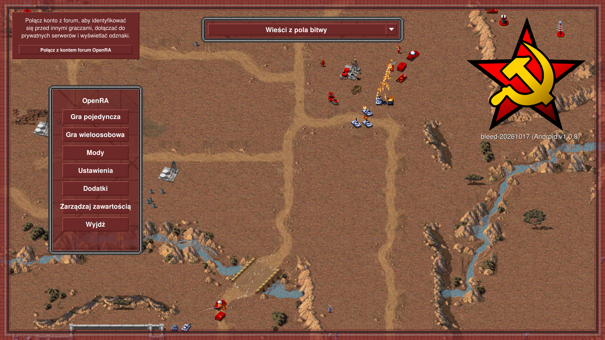
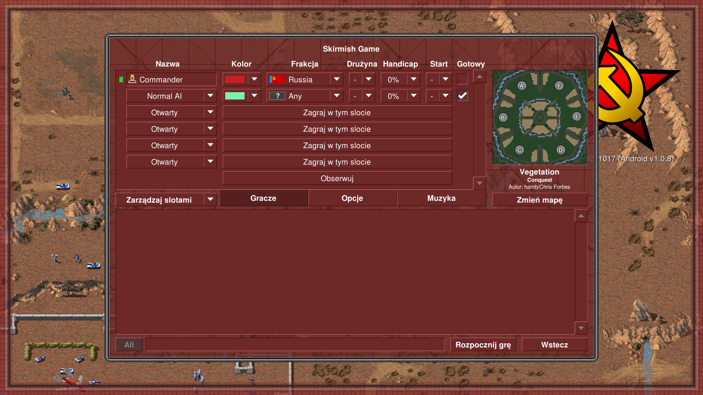
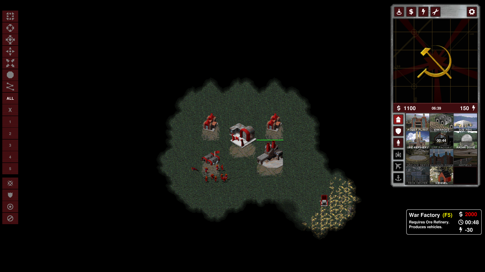
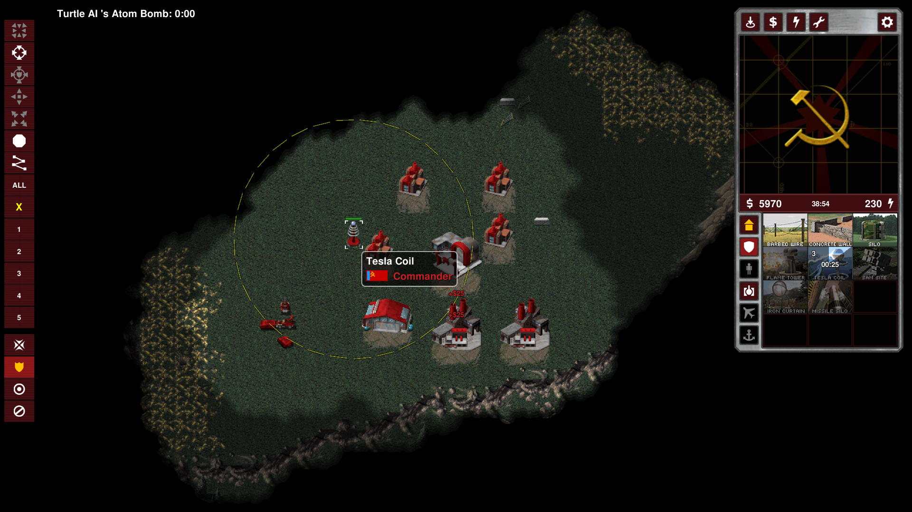

# OpenRA for Android (nOpenRA)

[English](#english) | [Polski](#polski)

---

<a name="english"></a>
## English

**OpenRA for Android** is an open-source mobile port of the [OpenRA](https://www.openra.net) Real-Time Strategy engine running natively on Android with touch-first ergonomics, hardware-accelerated OpenGL ES 3.0 graphics, and modern .NET runtime.

### 📸 Screenshots

| Main Menu | Skirmish Lobby | Base Expansion |
| :---: | :---: | :---: |
|  |  |  |

| Armored Strike Force | Base Defense (Tesla Coil) |
| :---: | :---: |
|  |  |

### 🎮 Supported Games & Mods
- **Command & Conquer: Red Alert** (`ra`)
- **Command & Conquer: Tiberian Dawn** (`cnc`)
- **Dune 2000** (`d2k`)
- **Command & Conquer: Tiberian Sun** (`ts`)
- **Custom & Community Mods**: Download and run external mods (`.zip` / `.oramod`) such as *Combined Arms*, *Romanov's Vengeance*, *Shattered Paradise*, and more.

### 📱 Key Mobile Features
- **Touch-First Controls**:
  - **Swipe / Drag**: Smooth battlefield scrolling with inertia.
  - **Tap**: Move, attack, deploy, and select units.
  - **Pinch to Zoom**: Natural two-finger camera zoom.
  - **Hold with Circular Timer**: Holding a finger triggers a radial sweep progress animation, seamlessly transitioning into rectangular box selection.
  - **Hold Duration Slider**: Configure hold delay (300ms - 2000ms) in Settings -> Input.
- **In-Game Action Bar**:
  - `ALL` button: Instantly select all own units visible on screen.
  - `X` button: Clear selection and reset active command mode.
  - Unit Group Buttons (`1` to `5`): Dynamic unit counters and quick selection/assignment.
- **In-Process Mod & Content Manager**:
  - Switch between Red Alert, Tiberian Dawn, Dune 2000, and Tiberian Sun directly within the game in seconds without restarting.
  - In-game mod downloader with preset links, progress reporting, and auto-extraction.
  - Custom data directory selection (e.g. `/storage/emulated/0/OpenRA`) bypassing Android 11+ scoped storage restrictions.
- **Multilingual & Localization**:
  - Dedicated Language & Translations tab in Settings with full support for English and Polish.

### 🛠️ Building & Packaging
#### Prerequisites:
- .NET 10 SDK with Android Workload (`dotnet workload install android`)
- Java Development Kit (JDK 17+)
- PowerShell (`pwsh`)
- Android SDK (API 34+)

#### Steps:
1. Clone the repository:
   ```bash
   git clone https://github.com/nurbsn/OpenRA.Android.git
   cd OpenRA.Android
   ```
2. Package game assets:
   ```bash
   pwsh -File OpenRA.Android/package-assets.ps1
   ```
3. Build the release APK:
   ```bash
   pwsh -File build-apk.ps1
   # or build directly with dotnet:
   dotnet publish OpenRA.Android/OpenRA.Android.csproj -f net10.0-android -c Release -p:AndroidPackageFormat=apk
   ```
4. Install on device or emulator:
   ```bash
   pwsh -File build-apk.ps1 -Install
   # or install directly via adb:
   adb install -r bin/net10.0-android/publish/eu.gfmm.nopenra-Signed.apk
   ```

### ⚖️ License & Disclaimer
OpenRA is distributed under the terms of the GNU General Public License v3.0 (GPLv3). See [COPYING](COPYING) for details.  
This project is an independent community port and is not affiliated with, endorsed, or sponsored by Electronic Arts Inc.

---

<a name="polski"></a>
## Polski

**OpenRA for Android** to otwartoźródłowy port silnika strategii czasu rzeczywistego [OpenRA](https://www.openra.net) dla systemu Android, działający natywnie na runtime .NET z akceleracją OpenGL ES 3.0 oraz dedykowanym, ergonomicznym sterowaniem dotykowym.

### 📸 Zrzuty ekranu

| Menu główne | Lobby potyczki | Rozbudowa bazy |
| :---: | :---: | :---: |
|  |  |  |

| Natarcie pancerne | Obrona bazy (Wieża Tesli) |
| :---: | :---: |
|  |  |

### 🎮 Obsługiwane gry i mody
- **Command & Conquer: Red Alert** (`ra`)
- **Command & Conquer: Tiberian Dawn** (`cnc`)
- **Dune 2000** (`d2k`)
- **Command & Conquer: Tiberian Sun** (`ts`)
- **Mody społeczności**: Możliwość pobierania i instalowania modów (`.zip` / `.oramod`) takich jak *Combined Arms*, *Romanov's Vengeance*, *Shattered Paradise* itp.

### 📱 Główne funkcje mobilne
- **Dedykowane sterowanie dotykowe**:
  - **Przesuwanie palcem (Swipe)**: Płynne przewijanie widoku pola bitwy.
  - **Pojedynczy tap**: Wydawanie rozkazów marszu, ataku oraz zaznaczanie jednostek.
  - **Pinch-to-zoom**: Zbliżanie i oddalanie kamery dwoma palcami.
  - **Przytrzymanie (Hold) z animacją kołową**: Przytrzymanie palca wyświetla zegarowy pierścień postępu, po czym aktywuje ramkę zaznaczania obszarowego.
  - **Konfiguracja czasu przytrzymania**: Suwak w Settings -> Input (300ms - 2000ms).
- **Lewy pasek akcji (Action Bar)**:
  - Przycisk `ALL`: Natychmiastowe zaznaczenie wszystkich własnych jednostek na ekranie.
  - Przycisk `X`: Odznaczenie jednostek i reset trybu rozkazu.
  - Przyciski grup (`1` - `5`): Dynamiczne liczniki jednostek w grupie oraz szybki wybór.
- **Menedżer Modów i Zawartości w grze**:
  - Przełączanie pomiędzy grami w locie bez konieczności restartu aplikacji.
  - Pobieranie modów z sieci z poziomu gry (pole URL, presety, pasek postępu, automatyczne rozpakowywanie).
  - Wybór własnego katalogu pamięci (np. `/storage/emulated/0/OpenRA`), omijający ograniczenia Androida 11+ (*Scoped Storage*).
- **Obsługa wielu języków (Język i Tłumaczenia)**:
  - Dedykowana zakładka w menu ustawień z pełnym wsparciem dla języka polskiego i angielskiego.

### 🛠️ Kompilacja i instalacja
#### Wymagania:
- .NET 10 SDK z pakietem Android (`dotnet workload install android`)
- JDK 17+
- PowerShell (`pwsh`)
- Android SDK (API 34+)

#### Instrukcja krok po kroku:
1. Sklonuj repozytorium:
   ```bash
   git clone https://github.com/nurbsn/OpenRA.Android.git
   cd OpenRA.Android
   ```
2. Spakuj zasoby gry:
   ```bash
   pwsh -File OpenRA.Android/package-assets.ps1
   ```
3. Zbuduj pakiet instalacyjny APK:
   ```bash
   pwsh -File build-apk.ps1
   # lub bezpośrednio przez dotnet:
   dotnet publish OpenRA.Android/OpenRA.Android.csproj -f net10.0-android -c Release -p:AndroidPackageFormat=apk
   ```
4. Zainstaluj na urządzeniu lub emulatorze:
   ```bash
   pwsh -File build-apk.ps1 -Install
   # lub bezpośrednio przez adb:
   adb install -r bin/net10.0-android/publish/eu.gfmm.nopenra-Signed.apk
   ```

### ⚖️ Licencja i oświadczenie
OpenRA jest projektem udostępnianym na warunkach licencji GNU General Public License v3.0 (GPLv3). Szczegóły w pliku [COPYING](COPYING).  
Projekt jest niezależnym przedsięwzięciem społecznościowym i nie jest powiązany z firmą Electronic Arts Inc., ani przez nią sponsorowany czy autoryzowany.
